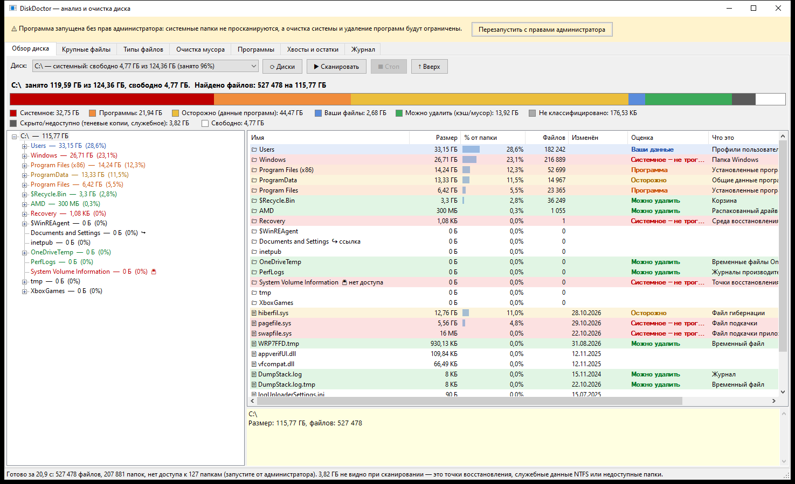
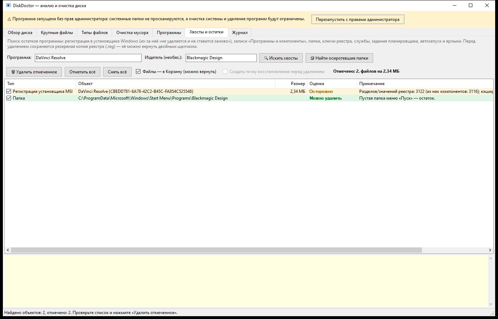

# DiskDoctor — анализ и очистка диска

Программа для Windows 10/11: показывает, что занимает место на диске, оценивает, что можно удалять, находит мусор
и вычищает остатки «сломанных» программ (например, DaVinci Resolve, который не удаляется и не ставится заново).

**Запуск:** `publish\DiskDoctor.exe`. При старте программа запрашивает права администратора (UAC). Без них она
работает в ограниченном режиме. Нужна среда выполнения .NET 8 Desktop Runtime (на этом ПК она уже установлена).



## Вкладки

| Вкладка | Что делает |
|---|---|
| **Обзор диска** | Сканирует диск или папку (весь C: — около 20 с). Цветная полоса показывает, сколько места занимает система, программы, данные программ, ваши файлы, мусор, скрытые данные (точки восстановления) и сколько свободно. Дерево папок и список содержимого отсортированы по размеру. У каждой папки и файла есть **оценка**: «Системное — не трогать», «Программа», «Осторожно», «Ваши данные», «Можно удалить», а также пояснение, что это и как правильно освободить место. Правая кнопка мыши — открыть, удалить в Корзину или навсегда, искать хвосты. Удалять системные объекты программа не даёт. |
| **Крупные файлы** | 500 самых больших файлов с оценкой. |
| **Типы файлов** | Сколько места занимают видео, архивы, образы, модели ИИ и т.д. |
| **Очистка мусора** | Временные файлы, кэш обновлений Windows, дампы, кэш браузеров (Chrome, Edge, Яндекс, Opera, Firefox и др.) и приложений (Discord, VS Code, Steam), кэш шейдеров, остатки драйверов NVIDIA/AMD, Корзина, битые ярлыки, кэши pip/npm/NuGet, Telegram, Windows.old, осиротевшие .msi в Windows\Installer. Внизу — системные инструменты: DISM (сжатие WinSxS), отключение гибернации (hiberfil.sys), точки восстановления, файл подкачки. |
| **Программы** | Список установленных программ с **проверкой целостности**: нет папки, нет деинсталлятора, запись-призрак, удалён кэш .msi, «файлы удалены, а регистрация в установщике Windows осталась». Проблемные программы показаны красным вверху списка. Кнопки «Удалить штатно» и «Принудительное удаление / хвосты». |
| **Хвосты и остатки** | Ищет всё, что связано с программой: регистрацию MSI (Products, Features, UpgradeCodes, тысячи Components, UserData, кэшированный .msi), записи «Программы и компоненты», папки в Program Files, ProgramData и AppData, ключи реестра, службы, задания планировщика, автозапуск, App Paths и ярлыки. Перед удалением создаётся **резервная копия реестра** (`Backups\<дата>\registry_backup.reg`) и, по желанию, точка восстановления. Кнопка «Найти осиротевшие папки» ищет папки, для которых нет установленной программы. |
| **Журнал** | Журнал всех действий (`DiskDoctor.log` рядом с exe). |

## Как починить DaVinci Resolve

На этом ПК программа нашла проблему: **DaVinci Resolve 18.6** зарегистрирован в установщике Windows (MSI),
но файлов программы уже нет. Деинсталлятор падает, а новый установщик видит «старую версию» и тоже не работает.

1. Запустите `DiskDoctor.exe` и подтвердите запрос прав администратора.
2. На вкладке **Программы** выберите *DaVinci Resolve* (строка будет красной) и нажмите **«Удалить штатно»**. Если удаление завершится ошибкой, программа сама предложит следующий шаг.
3. Нажмите **«Принудительное удаление / хвосты…»**. Отметится пункт «Регистрация установщика MSI» (около 3 100 записей реестра и кэшированный `af7e375.msi`) и пустая папка в меню «Пуск».
4. Нажмите **«Удалить отмеченное»**, затем перезагрузите компьютер и установите свежий DaVinci Resolve.

Если базы проектов Resolve остались в `ProgramData\Blackmagic Design`, программа предупредит об этом и не отметит
такую папку автоматически.



## Безопасность

* Системные объекты (Windows, System32, WinSxS, Windows\Installer, pagefile.sys, System Volume Information) удалить нельзя. Вместо этого программа подсказывает штатный способ.
* Во временных папках не трогаются файлы моложе 24 часов, а занятые файлы пропускаются.
* По умолчанию отмечаются только безопасные категории. Пункты «Осторожно» и найденное по издателю нужно отметить вручную.
* Удаление ключей реестра идёт только после экспорта в `.reg`. Чтобы восстановить, дважды щёлкните по файлу.

## Командная строка

```
DiskDoctor.exe --scan D:              сразу просканировать диск
DiskDoctor.exe --find "DaVinci Resolve" --publisher "Blackmagic Design"   сразу искать хвосты
DiskDoctor.exe --no-elevate           не запрашивать права администратора
DiskDoctor.exe --selftest report.txt [папка]   отчёт без интерфейса и без каких-либо удалений
```

## Сборка

```
dotnet publish -c Release -p:PublishSingleFile=true -p:DebugType=none -o publish
```
Исходники: `Core\` (сканер, классификатор, очистка, реестр/MSI, поиск хвостов), `UI\` и `MainForm*.cs` (интерфейс WinForms).
